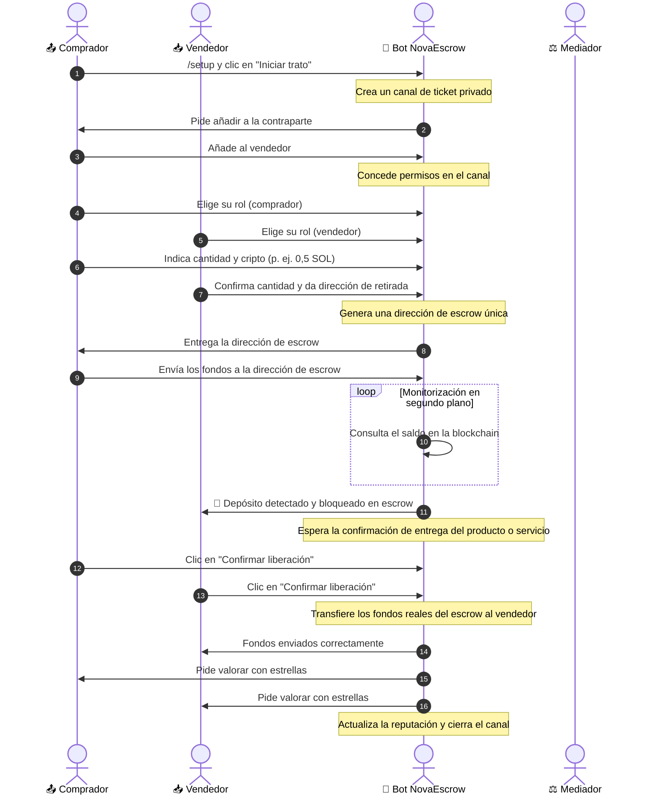
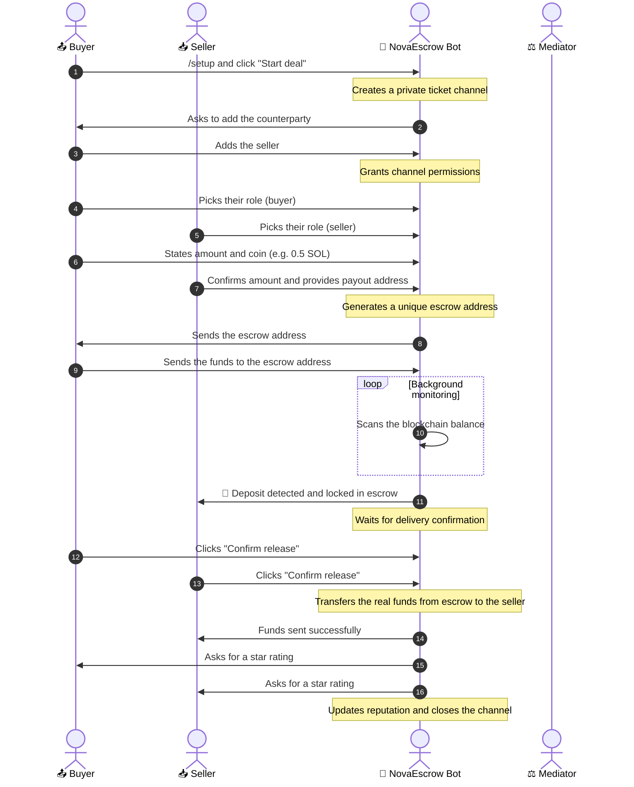

# 🔒 NovaEscrow — Bot de escrow multi-cadena para Discord

[](https://www.python.org)
[](https://discordpy.readthedocs.io/)
[](LICENSE)

[Español](#español) · [English](#english)

---

## Español

### Índice

- [Descripción](#descripción)
- [Características](#características)
- [Flujo de un trato](#flujo-de-un-trato)
- [Estructura del proyecto](#estructura-del-proyecto)
- [Instalación](#instalación)
- [Variables de entorno](#variables-de-entorno)
- [Comandos](#comandos)
- [Seguridad](#seguridad)
- [Licencia](#licencia)

### Descripción

**NovaEscrow** es un bot de **escrow (depósito en garantía)** de criptomonedas **multi-cadena** para comunidades de Discord. Permite el comercio P2P entre dos partes dentro de un canal privado, con seguimiento de la blockchain en tiempo real: el bot recibe los fondos del comprador, los bloquea y solo los libera cuando ambas partes confirman la entrega. Si hay conflicto, un administrador actúa como mediador.

### Características

- **Integración multi-cadena**
  - **Bitcoin (BTC)** y **Litecoin (LTC)**, en formato Legacy y Bech32.
  - **Ethereum (ETH)** y **tokens ERC-20** (USDT y USDC).
  - **Solana (SOL)**, transferencias del token nativo.
- **Direcciones deterministas de un solo uso**: cada trato deriva una dirección de escrow única a partir de una semilla `WALLET_MASTER_KEY`, usando hashing criptográfico y sal.
- **Cifrado de claves privadas con Fernet**: las claves derivadas se cifran en memoria con AES-128 en modo CBC y HMAC-SHA256 (Fernet). Nunca se manejan ni almacenan en texto plano.
- **Verificación automática en blockchain**: trabajadores en segundo plano consultan nodos RPC directos (Web3 para Ethereum, Web3 para Solana y la API de BlockCypher) para detectar depósitos entrantes.
- **Liberación con doble firma y sistema de disputas**: la liberación requiere confirmación del comprador y del vendedor; un administrador puede mediar y ejecutar reembolsos o pagos.
- **Reputación y perfiles de trading**: número de tratos completados, volumen total en USD, media de estrellas y reseñas escritas.
- **Monedero interno**: saldo de trading para operaciones instantáneas sin comisiones de red, con retirada a una dirección externa cuando se quiera.

### Flujo de un trato



### Estructura del proyecto

Arquitectura modular basada en **cogs**, con responsabilidades bien separadas:

```text
NovaEscrow/
│
├── src/
│   ├── database/               # Acceso a datos (SQLite / aiosqlite)
│   │   └── manager.py          # Tablas, consultas de perfil y saldos
│   │
│   ├── services/               # Integraciones blockchain
│   │   └── wallet.py           # Derivación de claves, transacciones y saldos
│   │
│   ├── utils/                  # Utilidades compartidas
│   │   └── logging.py          # Canal de auditoría estructurado
│   │
│   ├── ui/                     # Capa interactiva de Discord
│   │   └── views.py            # Botones, modales, menús y tareas en segundo plano
│   │
│   └── cogs/                   # Comandos slash por dominio
│       ├── escrow.py           # /setup, /cerrar, /info, /stats, /perfil
│       └── balance.py          # /balance, /depositar, /retirar
│
├── main.py                     # Punto de entrada, ligero
├── pyproject.toml              # Dependencias y empaquetado
├── .env.example                # Plantilla de configuración
└── README.md
```

### Instalación

**1. Requisitos**

Python **3.10 o superior**. Se recomienda [uv](https://github.com/astral-sh/uv) o `pip` para gestionar el entorno virtual.

**2. Clonar el repositorio**

```bash
git clone https://github.com/alberto2005-coder/NovaEscrow.git
cd NovaEscrow
```

**3. Instalar dependencias**

```bash
pip install -e .
```

**4. Configurar el entorno**

```bash
cp .env.example .env
```

Edita el `.env`:

```env
# Discord
DISCORD_TOKEN=tu_token_de_discord
LOG_CHANNEL_ID=id_del_canal_de_logs

# Blockchain
WALLET_MASTER_KEY=tu_clave_maestra_segura
INFURA_URL=https://mainnet.infura.io/v3/tu_project_id
SOLANA_RPC=https://api.mainnet-beta.solana.com
BLOCKCYPHER_TOKEN=tu_token_de_blockcypher
```

**5. Arrancar el bot**

```bash
python main.py
```

Después, usa `/setup` en el canal que hará de puerta de entrada a los tratos.

### Variables de entorno

| Variable | Obligatoria | Para qué |
|---|:-:|---|
| `DISCORD_TOKEN` | ✅ | Token del bot de Discord |
| `LOG_CHANNEL_ID` | ✅ | Canal donde se publican los registros de auditoría |
| `WALLET_MASTER_KEY` | ✅ | Semilla maestra de la que se derivan direcciones y claves de cada escrow |
| `INFURA_URL` | ✅ | Endpoint RPC de Ethereum |
| `SOLANA_RPC` | ✅ | Endpoint RPC de Solana |
| `BLOCKCYPHER_TOKEN` | ✅ | API de BlockCypher para BTC y LTC |

> [!IMPORTANT]
> **`WALLET_MASTER_KEY`**: guárdala con extremo cuidado. Todas las direcciones y claves de un solo uso se derivan de ella. Si la pierdes, **los fondos en escrow no se pueden recuperar**; si se filtra, un atacante puede derivar las claves. Usa un secreto fuerte y persistente (el bot genera uno si se deja vacío, pero no es lo recomendable).

### Comandos

**Administración**

| Comando | Qué hace |
|---|---|
| `/setup` | Configura el canal actual como puerta de entrada para iniciar tratos (requiere permisos de administrador) |

**Operaciones de trato**

| Comando | Qué hace |
|---|---|
| `/cerrar` | Cierra y elimina el canal de ticket activo (participantes o administradores) |

**Perfil y analíticas**

| Comando | Qué hace |
|---|---|
| `/perfil [@usuario]` | Estadísticas de trading: tratos completados, estrellas y volumen en USD |
| `/info` | Funciones del bot, criptomonedas soportadas y lista de comandos |
| `/stats` | Estadísticas globales del servidor: tickets, tratos completados y disputas activas |

**Monedero**

| Comando | Qué hace |
|---|---|
| `/balance` | Saldos del monedero interno en todas las criptomonedas soportadas |
| `/depositar` | Dirección determinista para recargar el monedero interno |
| `/retirar` | Modal para transferir fondos del monedero interno a una dirección externa |

### Seguridad

1. **Aislamiento determinista**: cada par de claves de un solo uso se deriva con el ID del canal y un nonce, evitando reutilizar direcciones entre tratos.
2. **Carga segura de claves**: la clave maestra y las URLs RPC se leen del entorno (`.env`) y nunca se escriben en el código.
3. **Rastro de auditoría**: cada evento (confirmación de roles, depósitos, liberaciones, disputas y retiradas) se publica en el canal de administración configurado en `LOG_CHANNEL_ID`.
4. **Sin claves privadas en texto plano**: las claves temporales se cifran con Fernet en cuanto se derivan y solo se descifran en memoria al firmar la transacción.

### Licencia

**GNU General Public License v3.0 (GPL-3.0)**. Consulta [LICENSE](LICENSE).

---

## English

### Table of contents

- [Overview](#overview)
- [Features](#features)
- [Deal flow](#deal-flow)
- [Project structure](#project-structure)
- [Installation](#installation)
- [Environment variables](#environment-variables)
- [Commands](#commands)
- [Security](#security)
- [License](#license)

### Overview

**NovaEscrow** is a **multi-chain cryptocurrency escrow bot** for Discord communities. It enables secure, trustless peer-to-peer trading inside a private channel, backed by real-time blockchain monitoring: the bot receives the buyer's funds, locks them, and only releases them once both sides confirm delivery. If a conflict arises, an administrator steps in as mediator.

### Features

- **Multi-chain integration**
  - **Bitcoin (BTC)** and **Litecoin (LTC)**, Legacy and Bech32 formats.
  - **Ethereum (ETH)** and **ERC-20 tokens** (USDT and USDC).
  - **Solana (SOL)**, native token transfers.
- **Deterministic single-use addresses**: every deal derives a unique escrow address from a single `WALLET_MASTER_KEY` seed using cryptographic hashing and salt.
- **Fernet private-key encryption**: derived keys are encrypted in memory with AES-128 in CBC mode plus HMAC-SHA256 (Fernet). Private keys are never handled or stored in plain text.
- **Automatic blockchain verification**: background workers query direct RPC nodes (Web3 for Ethereum, Web3 for Solana and the BlockCypher API) to detect incoming deposits.
- **Dual-signature release and disputes**: release requires confirmation from both buyer and seller; an administrator can mediate and execute refunds or payouts.
- **Reputation and trading profiles**: completed deals, total trading volume in USD, average star rating and written reviews.
- **Internal wallet**: a trading balance for instant, gas-free trades, with withdrawal to an external address at any time.

### Deal flow



### Project structure

A clean, highly decoupled **modular cog-based** architecture:

```text
NovaEscrow/
│
├── src/
│   ├── database/               # Data access (SQLite / aiosqlite)
│   │   └── manager.py          # Tables, profile queries and balances
│   │
│   ├── services/               # Blockchain integrations
│   │   └── wallet.py           # Key derivation, transactions and balances
│   │
│   ├── utils/                  # Shared helpers
│   │   └── logging.py          # Structured audit channel
│   │
│   ├── ui/                     # Discord interactive layer
│   │   └── views.py            # Buttons, modals, dropdowns and background tasks
│   │
│   └── cogs/                   # Slash commands by domain
│       ├── escrow.py           # /setup, /cerrar, /info, /stats, /perfil
│       └── balance.py          # /balance, /depositar, /retirar
│
├── main.py                     # Lightweight entry point
├── pyproject.toml              # Dependencies and packaging
├── .env.example                # Configuration template
└── README.md
```

### Installation

**1. Requirements**

Python **3.10 or later**. [uv](https://github.com/astral-sh/uv) or `pip` is recommended for the virtual environment.

**2. Clone the repository**

```bash
git clone https://github.com/alberto2005-coder/NovaEscrow.git
cd NovaEscrow
```

**3. Install dependencies**

```bash
pip install -e .
```

**4. Configure the environment**

```bash
cp .env.example .env
```

Edit `.env`:

```env
# Discord
DISCORD_TOKEN=your_discord_bot_token
LOG_CHANNEL_ID=your_log_channel_id

# Blockchain
WALLET_MASTER_KEY=your_cryptographically_secure_master_key
INFURA_URL=https://mainnet.infura.io/v3/your_infura_project_id
SOLANA_RPC=https://api.mainnet-beta.solana.com
BLOCKCYPHER_TOKEN=your_blockcypher_api_token
```

**5. Start the bot**

```bash
python main.py
```

Then run `/setup` in the channel that will act as the entry point for deals.

### Environment variables

| Variable | Required | Purpose |
|---|:-:|---|
| `DISCORD_TOKEN` | ✅ | Discord bot token |
| `LOG_CHANNEL_ID` | ✅ | Channel where audit logs are published |
| `WALLET_MASTER_KEY` | ✅ | Master seed every escrow address and key is derived from |
| `INFURA_URL` | ✅ | Ethereum RPC endpoint |
| `SOLANA_RPC` | ✅ | Solana RPC endpoint |
| `BLOCKCYPHER_TOKEN` | ✅ | BlockCypher API for BTC and LTC |

> [!IMPORTANT]
> **`WALLET_MASTER_KEY`**: keep it extremely secure. Every single-use address and key is derived from it. If lost, **escrow funds cannot be retrieved**; if leaked, an attacker can derive the keys. Use a strong, persistent secret (the bot generates one when left empty, but that is not recommended).

### Commands

**Administration**

| Command | What it does |
|---|---|
| `/setup` | Configures the current channel as the entry point for escrow deals (requires administrator privileges) |

**Deal operations**

| Command | What it does |
|---|---|
| `/cerrar` | Cleanly closes and deletes the active ticket channel (participants or admins) |

**Profile and analytics**

| Command | What it does |
|---|---|
| `/perfil [@user]` | Trading stats: completed deals, stars and USD volume |
| `/info` | Bot features, supported cryptocurrencies and command list |
| `/stats` | Global server stats: tickets, completed deals and active disputes |

**Wallet**

| Command | What it does |
|---|---|
| `/balance` | Internal wallet balances across every supported coin |
| `/depositar` | Deterministic address to top up the internal wallet |
| `/retirar` | Modal to move internal funds to an external address |

### Security

1. **Deterministic isolation**: single-use keypairs are derived with the channel ID and a nonce, preventing address reuse across deals.
2. **Secure key loading**: the master key and RPC URLs are read from the environment (`.env`) and never hardcoded.
3. **Audit trail**: every event (role confirmations, deposits, releases, disputes and withdrawals) is published to the admin channel set in `LOG_CHANNEL_ID`.
4. **No plaintext private keys**: temporary keys are encrypted with Fernet as soon as they are derived and only decrypted in memory while signing.

### License

**GNU General Public License v3.0 (GPL-3.0)**. See [LICENSE](LICENSE).
